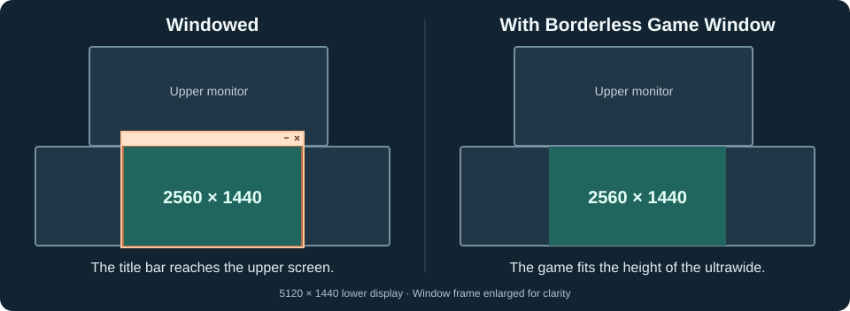

# Borderless Game Window

Want to play at 16:9 in the middle of an ultrawide, but your game's Windowed mode leaves a white title bar across the top? Borderless Game Window removes the Windows title bar and frame, keeps the game's chosen client resolution, and centers the window on its own monitor. Add a game once and launch it as usual.

**[Download Borderless Game Window for Windows (x64)](https://github.com/Coolcooli/BorderlessGameWindow/releases/latest/download/BorderlessGameWindow.exe)**

## A 1440p game with a second screen above it

Some games fill the whole desktop in their built-in borderless mode. Switching to Windowed lets you choose **2560 × 1440** on a **5120 × 1440** ultrawide. The picture is exactly as tall as the screen, and the Windows title bar and frame add extra height. If you drag the window up to get the bottom of the picture back on screen, the top of the window can spill onto the monitor above.



With the frame removed, all **2560 × 1440** game pixels fit on the lower screen, with **1280 pixels on each side**. The upper screen stays clear for chat, a stream or a browser. This layout was tested with **Arena Breakout: Infinite** running in Windowed mode.

## Get started

1. Save `BorderlessGameWindow.exe` where you want to keep it and open it. The watch list starts empty.
2. Click **Add game…** and choose the executable that owns the game window. For example, choose `UAGame.exe` for Arena Breakout: Infinite or `ROB RUN.exe` for ROB RUN. If you launch through Steam, **Browse local files** can help you find it.
3. In the game's display settings, choose **Windowed** and your preferred resolution. The app also picks up a game that's already open. Look for **Borderless** and the resolution in the **Window status** column.
4. Click **Hide to tray** and play. Double-click the tray icon to open settings. **Remove** restores one game's original frame and placement. **Restore windows and exit** restores all managed windows and quits.

The app centers each game on the monitor containing the largest part of its window. If the selected size is larger than that entire monitor, the app scales the window down proportionally to keep all four edges on screen.

## Games that run as administrator

If **Window status** says **Windows denied access to this window**, check whether the game is running as administrator. Windows can block the frame change when the game runs with higher privileges than the app.

To use this mode, exit the app and copy the exe into its own administrator-protected folder, such as `C:\Program Files\Borderless Game Window\`. Open that copy, enable **Use administrator privileges**, and approve the Windows prompt. The app restarts in the tray and picks up the open game. This setting is **off by default**.

**Start in the tray when I sign in** is on by default and can be changed independently. With administrator mode enabled, Windows Task Scheduler handles subsequent sign-ins without another approval prompt.

## Using it with Taskbar Control

If the Windows taskbar pops up when your cursor reaches a menu at the bottom of the game, **Taskbar Control** handles that separately. You can use either utility on its own. [Taskbar Control on GitHub](https://github.com/Coolcooli/TaskbarControl)

## Build from source

The app uses C#, Windows Forms and external Windows window-management APIs. On 64-bit Windows 10 or 11 with .NET Framework 4.8, run the build script from PowerShell in the repository folder.

```powershell
.\build.ps1
```

The script builds `BorderlessGameWindow.exe` in that folder using the Windows .NET Framework compiler.
